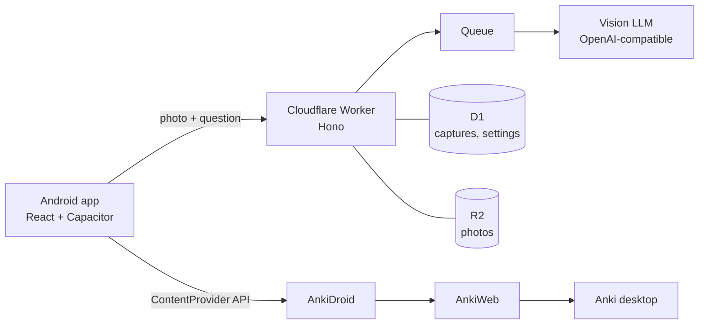

<p align="center">
  
</p>

<h1 align="center">Anki Everything</h1>

<p align="center">
  <b>Photograph anything. Get one Anki card that teaches it.</b>
</p>

<p align="center">
  <a href="LICENSE"></a>
  <a href="https://github.com/T-64/anki-everything/actions/workflows/ci.yml"></a>
  
  
</p>

<p align="center">
  <a href="README.zh-CN.md">中文说明</a>
</p>

---

A medicine box in a language you're learning. A plant you keep walking past. A slide from today's lecture. The things worth remembering are the ones you actually ran into, and the photo of where you met them is the best memory hook there is.

Anki Everything turns each of those moments into a single flashcard that goes straight into AnkiDroid:

1. **Snap** a photo, or share a screenshot into the app. Pick how to turn it into a card, and optionally ask one question.
2. **AI explains it**, following a prompt **you** write. Or skip AI and write the card yourself.
3. **Review the draft**: edit, highlight, crop.
4. **It lands in AnkiDroid**: in your normal collection, synced by AnkiWeb, scheduled by Anki like any other card.

## Three ways to make a card

| Mode | Needs a model key | What you get |
| --- | --- | --- |
| **Language** | yes | For learning a language from real text. The model transcribes the photo, picks 1–3 key sentences, and explains them: translation, meaningful chunks, words with **compound and morpheme breakdown** and English cognates, a grammar note. You choose the sentences and words. |
| **General** | yes | For anything else: plants, artworks, recipes, slides, manuals. Your prompt decides what goes on the front and back; the back is Markdown. |
| **No AI** | no | The photo plus whatever you type, or nothing at all. Works on a server without any model key. |

Example from the word section of a Language card:

```
Packungsbeilage  die, -n   package leaflet
  Packung (package) + bei (along with) + legen (to lay) + -e
  ≈ English: "pack" + "lay"
```

## Your prompts, not ours

Prompts live in the app's **Settings** page and are stored in your own database, not in this repo. Leave a prompt empty and the example in [`prompts/examples`](prompts/examples) is used.

Your prompt only controls **how** the model explains: tone, focus, examples. The output format (fields, JSON, "don't invent what you can't read") is fixed in [`src/worker/services/contract.ts`](src/worker/services/contract.ts) and appended after your prompt, so the review screen and card rendering always work.

Settings also hold the language you're learning, the language for explanations, your level and the Anki deck.

## How it works



- **No Anki add-on, no fork.** The app writes through AnkiDroid's official [ContentProvider API](https://github.com/ankidroid/Anki-Android/wiki/AnkiDroid-API). Cards get tagged `ae::language`, `ae::general` or `ae::manual`, so you can filter them in Anki.
- **The server does the slow part.** Analysis runs in a Cloudflare Queue consumer, so you can close the app right after taking the photo. Streaming responses keep long "thinking" runs alive.
- **Offline-tolerant.** Photos taken without a connection wait in a local queue and upload later.
- **Idempotent writes.** Every note carries a hidden ID; the app checks before writing, so retries and second phones never create duplicates.

## Self-hosting

You run your own Worker; the app asks for its address on the login screen, so one APK works for everyone. Personal use fits in Cloudflare's free plan.

### Requirements

- Node 24, a Cloudflare account and [`wrangler`](https://developers.cloudflare.com/workers/wrangler/) (installed with the project)
- Optional: an API key for an **OpenAI-compatible vision model** with JSON output. Developed on Zhipu `glm-5.3-flash` with thinking enabled. Without a key, only No AI mode is available.
- For building the APK yourself: JDK 21 and Android SDK 36
- On the phone: [AnkiDroid](https://play.google.com/store/apps/details?id=com.ichi2.anki)

### 1. Run locally

```bash
git clone https://github.com/T-64/anki-everything.git
cd anki-everything
npm install
cp .dev.vars.example .dev.vars        # set APP_KEY; LLM_API_KEY is optional
npx wrangler d1 migrations apply anki-everything --local
npm run dev                            # http://localhost:5173
```

The web version shows the whole flow; only writing to AnkiDroid needs the Android app.

### 2. Deploy the Worker

```bash
npx wrangler d1 create anki-everything            # put the printed database_id into wrangler.jsonc
npx wrangler r2 bucket create anki-everything-images
npx wrangler queues create anki-everything-analyze
npx wrangler secret put APP_KEY                     # the access key you type into the app
npx wrangler secret put LLM_API_KEY                 # optional
npm run deploy
```

### 3. Install the app

Download the APK from [Releases](https://github.com/T-64/anki-everything/releases), or build it:

```bash
npm run apk                            # debug build
```

For a signed release build, create a keystore and `android/keystore.properties`:

```bash
keytool -genkey -v -keystore android/release.jks -alias release -keyalg RSA -keysize 2048 -validity 10000
```

```properties
storeFile=release.jks
storePassword=…
keyAlias=release
keyPassword=…
```

```bash
npm run apk:release                    # → release/AnkiEverything-<version>.apk
```

> Back up `release.jks` and `keystore.properties`. Without them you can't ship updates that install over the existing app.

Install AnkiDroid first, then the APK. On first launch, enter your Worker's address and access key, then allow access to AnkiDroid. To prefill the address in your own builds, copy `.env.app.example` to `.env.app.local`.

### Server configuration

In `wrangler.jsonc` → `vars`; everything about cards and prompts is in the app's Settings instead.

| Variable | Default | |
| --- | --- | --- |
| `LLM_ENDPOINT` | Zhipu | Any OpenAI-compatible `chat/completions` URL |
| `LLM_MODEL` | `glm-5.3-flash` | Must accept images |
| `LLM_THINKING` | `enabled` | Reason before answering: slower (1–2 min), but far fewer invented etymologies |
| `APP_TIME_ZONE` | `Europe/Berlin` | Card dates and the daily limit |
| `DAILY_CAPTURE_LIMIT` | `50` | AI captures per 24 h, to protect your model bill |

## Development

```bash
npm test             # vitest: API end to end (D1 emulated with node:sqlite), modes, rendering, Anki writes, offline queue
npm run typecheck
npm run format
```

```
src/shared/   card formats (zod), card rendering (Anki field HTML + CSS), Markdown subset
src/worker/   API, queue consumer, model calls; contract.ts is the output format
src/client/   UI (React 19, Motion, Zustand); anki.ts writes to AnkiDroid, offline.ts queues uploads
android/      Capacitor project; AnkiBridgePlugin (AnkiDroid), ShareInboxPlugin (share sheet)
migrations/   D1 schema
prompts/      example prompts; your own go in Settings or prompts.local/ (gitignored)
```

See [CONTRIBUTING.md](CONTRIBUTING.md) before opening a pull request.

## Status and limits

Built for daily use and used daily. Honest caveats:

- **Android only**: iOS has no AnkiDroid-style API for writing cards.
- **The UI is in Chinese.** Copy lives in [`src/client/i18n`](src/client/i18n), so adding a language means adding one dictionary.
- **Language mode is tuned for German → Simplified Chinese.** Other pairs work through Settings, but haven't been tested much.
- **The model can still be wrong.** The draft step exists so you check before it becomes a card.
- **Some Android skins** (vivo, Xiaomi, …) freeze AnkiDroid in the background. The app detects this and offers to open AnkiDroid.

## Roadmap

- [ ] Auto-crop: the model returns where the key part is; the card image defaults to that region
- [ ] Auto-rotate: straighten photos taken at an angle
- [ ] English UI

## Privacy

Your photos go to **your** Worker and **your** model provider, nowhere else. Card images sync through your own AnkiWeb account. Crop out names and numbers before confirming if that matters to you.

## License

[AGPL-3.0](LICENSE). If you run a modified version as a service for others, you must share your changes.

Not affiliated with Anki or AnkiDroid. Anki is a project by Ankitects; AnkiDroid is its open-source Android client.
